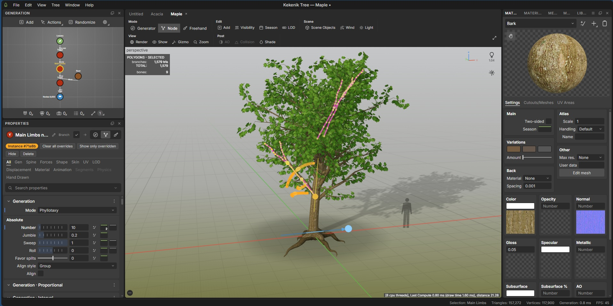

# Kekenik Tree

**مولّد گیاه و درخت رویه‌ای (procedural) مبتنی بر نود که کاملاً داخل مرورگر اجرا می‌شود.**

[English README](README.md) · [نسخه‌ی آنلاین](https://adam1442.github.io/Kekenik-Tree/)

<p align="center"></p>

## امکانات

- گراف تولید نود-محور: Tree ← Trunk ← Branch / Root / Spine ← Leaf / Frond / Cap / Decoration / Mesh؛ با Undo/Redo، ذخیره‌ی خودکار و بازیابی بعد از کرش. گراف و seed یکسان همیشه گیاه یکسان می‌سازد.
- نیروها (Forces) و باد سلسله‌مراتبی روی GPU همراه با Timeline.
- متریال‌ها و نقشه‌های بافت، Material Set، Mask و Displacement.
- ویرایشگر Cutout/Mesh و ویرایشگر منحنی (Curve / Ramp).
- LOD ها و خروجی GLB، glTF، OBJ، PLY و STL (به‌همراه AO پخته‌شده و Impostor).
- رابط داک‌شونده (پنل‌های قابل چسباندن، تب‌دار و شناور) و ۱۶ گونه‌ی آماده در کتابخانه.

## اجرا

نیازمندی‌ها: Node.js نسخه‌ی ۲۰٫۱۹ یا بالاتر و npm.

```bash
git clone https://github.com/adam1442/Kekenik-Tree.git
cd Kekenik-Tree
npm ci
npm run dev
```

ساخت نسخه‌ی نهایی: `npm run build` (خروجی در `dist/index.html` به‌صورت یک فایل مستقل).

## مستندات

- [راهنمای کاربر](docs/USER_GUIDE.md) · [معماری](docs/ARCHITECTURE.md) · [راهنمای توسعه‌دهنده](docs/DEVELOPER_GUIDE.md)
- [مشارکت در پروژه](CONTRIBUTING.md) · [مجوز MIT](LICENSE)

## توضیح

Kekenik Tree یک پروژه‌ی متن‌باز مستقل است که از روند کاری نرم‌افزارهای نود-محور تولید پوشش گیاهی الهام گرفته؛ با هیچ محصول تجاری وابستگی یا تأییدیه‌ای ندارد.

ارتباط: hossein.r.1442@gmail.com
