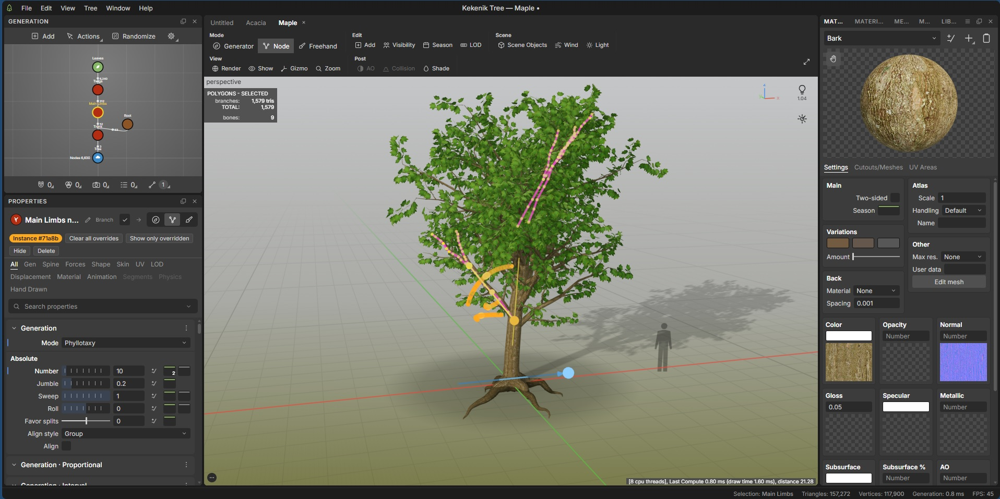

# Kekenik Tree

**A node-based procedural plant and tree generator that runs 100 % in your browser.**

[](https://github.com/adam1442/Kekenik-Tree/actions/workflows/ci.yml)
[](https://github.com/adam1442/Kekenik-Tree/actions/workflows/deploy.yml)
[](LICENSE)
[](https://www.typescriptlang.org/)
[](https://threejs.org/)
[](https://github.com/adam1442/Kekenik-Tree/stargazers)

<p align="center"></p>

[English](README.md) · [فارسی](README.fa.md)

## Live demo

**https://adam1442.github.io/Kekenik-Tree/** — no installation, no account, nothing is uploaded: everything runs locally in your browser.

## Features

- **Node-based procedural generation** — a generation graph (Tree → Trunk → Branch / Root / Spine → Leaf / Frond / Cap / Decoration / Mesh) with live, cached, cancellable evaluation, undo/redo, node templates, autosave and crash recovery. The same graph and seed always produce the same plant.
- **Generators** — Trunk, Branch, Root, Spine, Frond, Leaf, Cap, Decoration and Mesh nodes, plus Split, Knot and Cluster helpers. Every parameter has a tooltip, an optional random variance and, where it makes sense, a curve that varies it along the parent ([parameter reference](docs/PARAMETERS.md)).
- **Forces & wind** — gravity/attractor style forces, hierarchical GPU wind (trunk, branch and leaf levels), a wind timeline and per-node wind response.
- **Materials & texture maps** — color, opacity, normal and other slots, material sets (e.g. Summer/Autumn/Winter), masks, procedural default maps, alpha-coverage preserving mips and several viewport anti-aliasing modes.
- **Cutout / mesh editor** — author leaf and cluster cutouts, outlines, straighten axes and attachment anchors ([details](docs/CUTOUT_ATTACHMENT.md)).
- **Curve editor** — a full curve and color-ramp editor with presets, tangent modes, relative/absolute values and a freehand draw tool.
- **Displacement** — height-map displacement of generated branches with live updates.
- **LODs** — configurable LOD levels with a viewport preview.
- **Export** — GLB, glTF, OBJ, PLY and STL, including LODs, baked ambient occlusion and billboard impostors ([export specification](docs/EXPORT_SPEC.md)).
- **Docking UI** — dockable, tabbable and floating panels with saved layouts; an instance-level **Node mode** for per-branch editing ([details](docs/NODE_MODE.md)).
- **Presets** — a library of 16 species built from the real graph (Oak, Maple, Spruce, Pine, Birch, Willow, Palm, Acacia, Baobab, Dead Tree, Shrub, Fern, Cactus, Succulent Rosette, Bamboo, Young Sapling), user presets and `.ktree` project import/export.
- **Onboarding & preferences** — welcome screen, interactive tour, shortcut cheat sheet, UI scale, navigation schemes (Kekenik, Maya-like, Blender-like) and performance mode.

## Quick start

Requirements: Node.js 20.19 or newer (see `.nvmrc`) and npm.

```bash
git clone https://github.com/adam1442/Kekenik-Tree.git
cd Kekenik-Tree
npm ci
npm run dev
```

Open the URL printed by Vite (by default `http://localhost:5173/`).

## Build & preview

```bash
npm run build      # production build -> dist/index.html (one self-contained file)
npm run preview    # serve the production build locally
```

The production build is a single `dist/index.html` with all JavaScript, CSS and the bundled Inter font inlined, so it runs from any URL, from a sub-path such as GitHub Pages, or straight from disk. Asset links (favicon, manifest) are relative, so no configuration is needed for sub-path hosting.

Other scripts: `npm run typecheck`, `npm run lint`, `npm test`, `npm run licenses` (regenerates `THIRD_PARTY_NOTICES.md`).

## Usage basics

1. **Open a species** from the Welcome window or *Window ▸ Layout ▸ Library*.
2. **Look around** in the viewport: left-drag orbit, middle-drag or `Shift`+left-drag pan, wheel zoom.
3. **Tweak** — select a node in the *Generation* graph and edit its parameters in the *Properties* panel. `Shift+R` randomizes the seed.
4. **Wind** — open *Window ▸ Wind & Timeline*, set direction/strength and press play.
5. **Export** — *File ▸ Export…* (`Ctrl+E`), choose the format, LODs, texture size and extras.

The full walkthrough is in the [User Guide](docs/USER_GUIDE.md).

### Keyboard shortcuts

| Shortcut | Action |
|---|---|
| `Ctrl+N` / `Ctrl+O` / `Ctrl+S` / `Ctrl+Shift+S` | New / open / save / save as |
| `Ctrl+E` | Export |
| `Ctrl+Z` / `Ctrl+Shift+Z` (or `Ctrl+Y`) | Undo / redo |
| `Ctrl+C` / `Ctrl+X` / `Ctrl+V` / `Ctrl+D` | Copy / cut / paste / duplicate nodes |
| `Delete` | Delete selection |
| `Tab` or double-click in the graph | Add node |
| `F` / `Shift+F` / `Home` | Frame / zoom to selection / reset camera |
| `Alt+1` … `Alt+9` | Viewport display modes |
| `Shift+G` | Regenerate |
| `Shift+R` | Randomize seed |
| `Shift+Space` | Maximize panel |
| `?` or `F1` | Keyboard shortcut sheet |

On macOS use `⌘` instead of `Ctrl`.

## Browser requirements

A modern desktop browser with **WebGL2** and hardware acceleration enabled (current Chrome, Edge, Firefox or Safari). The app works offline once loaded and makes no network requests of its own.

## Project structure

```
src/
  contracts/   shared types (graph, params, skeleton, mesh, material, project ...)
  core/        math, seeded RNG, noise, curve & ramp engine, events
  graph/       graph model, evaluation engine, node registry
  nodes/       node definitions (generators, forces, materials, wind, output ...)
  geometry/    mesh builders (tubes, ribbons, leaves, cutouts)
  materials/   materials, texture maps, cutout/mesh editor logic
  forces/      force fields and solver
  instances/   per-instance identity and overrides (Node mode)
  viewport/    three.js viewport, overlays, gizmos, wind shader, quality
  export/      GLB / glTF / OBJ / PLY / STL writers, LODs, baking, impostors
  presets/     species library and thumbnails
  app/         application shell: store, commands, projects, engine host
  ui/          docking system, panels, widgets, theme (CSS tokens)
tests/         vitest unit and DOM tests
docs/          architecture, guides, parameter reference, export specification
```

## Architecture

The layers, data flow and extension points (registries for nodes, panels, widgets and exporters) are described in [docs/ARCHITECTURE.md](docs/ARCHITECTURE.md). Contributor setup is in [docs/DEVELOPER_GUIDE.md](docs/DEVELOPER_GUIDE.md).

## Contributing

Contributions are welcome — see [CONTRIBUTING.md](CONTRIBUTING.md) and the [Code of Conduct](CODE_OF_CONDUCT.md). Security issues: [SECURITY.md](SECURITY.md). Release history: [CHANGELOG.md](CHANGELOG.md).

## Roadmap

Not implemented yet:

- **Freehand mode** — the toolbar switch exists but hand-drawing branches is not available.
- Additional placement area shapes (only the circular Tree disc exists).
- Evaluation in a Web Worker (the engine is DOM-free and ready for it; it currently runs on the main thread with a time budget).
- LOD definitions are stored per browser, not inside the project file.
- Complete Persian translation of the UI (English is complete; Persian is partial).

## License

Released under the [MIT License](LICENSE). Third-party components are listed in [THIRD_PARTY_NOTICES.md](THIRD_PARTY_NOTICES.md).

## Disclaimer

Kekenik Tree is an independent open-source project inspired by node-based procedural vegetation workflows. It is not affiliated with, endorsed by, or derived from any commercial product, and product names such as SpeedTree are trademarks of their respective owners.

## Acknowledgments

- [three.js](https://threejs.org/) — 3D rendering (MIT)
- [fflate](https://github.com/101arrowz/fflate) — compression for project files (MIT)
- [Inter](https://rsms.me/inter/) via [@fontsource/inter](https://fontsource.org/fonts/inter) — UI typeface (SIL OFL 1.1)
- [Vite](https://vitejs.dev/), [Vitest](https://vitest.dev/), [TypeScript](https://www.typescriptlang.org/) and [ESLint](https://eslint.org/) — tooling

## Contact

Author: adam1442 — hossein.r.1442@gmail.com
